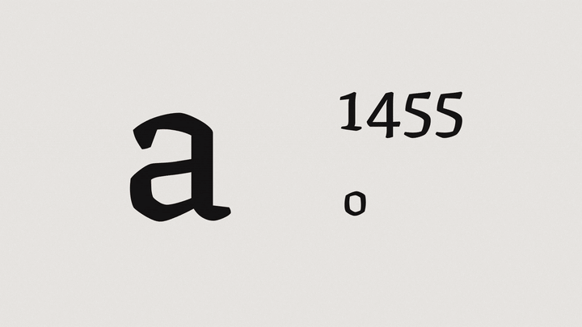
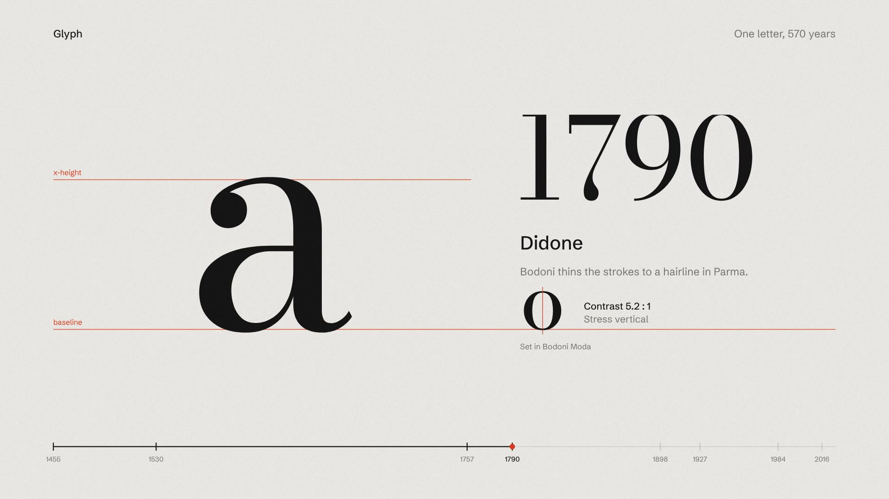
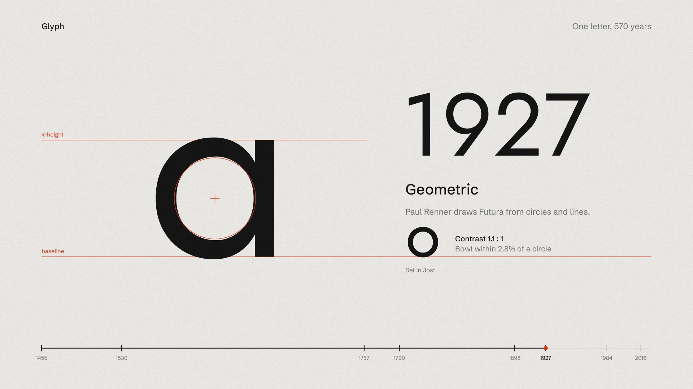
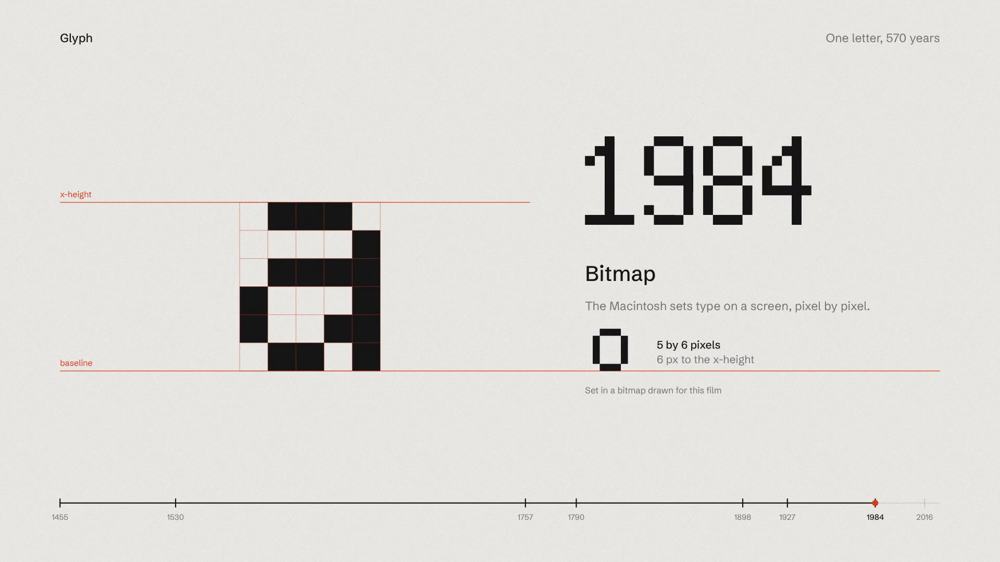
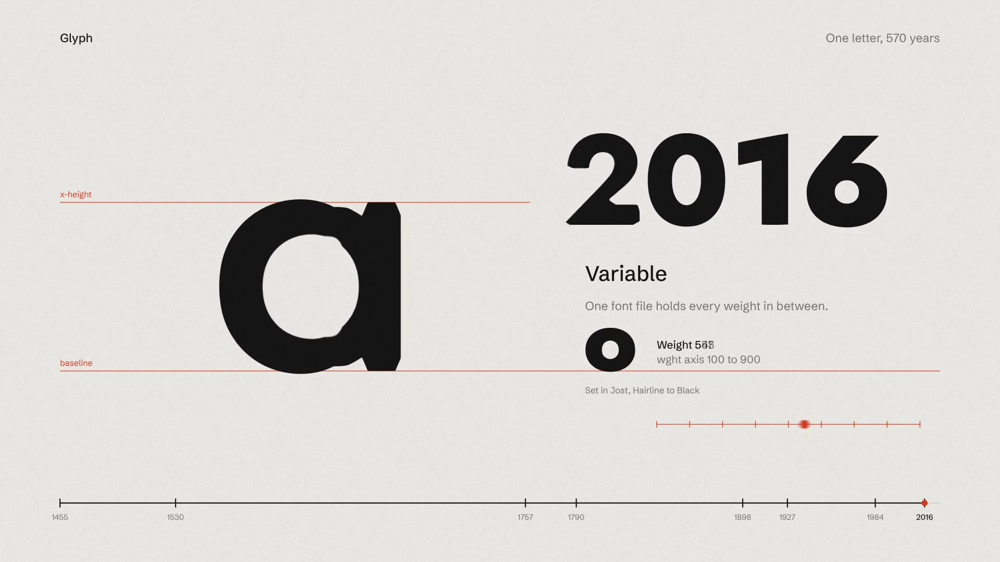

# Glyph

**One letter morphs through 570 years of type. Every number on screen is measured from the outlines you are looking at.**



Watch the full film: [16:9, 38 s](media/glyph-16x9.mp4) · [1:1, 38 s](media/glyph-1x1.mp4)

Glyph is a 38-second, code-rendered motion film. A single lowercase *a* travels from Gutenberg's blackletter (1455) to variable fonts (2016) without a cut. Around it, the film measures each typeface live: stroke contrast and the axis of stress are computed from that typeface's own *o*, and the geometric era fits a least-squares circle to the bowl of the single-story *a*. Nothing on screen is typed in by hand except the history.

The score is synthesized in code, so it can travel through the same time: organ and bells, then lute, harpsichord, strings, a machine room, swing, chiptune and a supersaw. The supersaw's filter follows the font-weight curve on screen, the odometer ticks land on the rolling year digits, and the finale's plucks land as each specimen letter does.

## The eight stops

| Year | Class | Typeface used (open licence) | Measured on its *o* |
| --- | --- | --- | --- |
| 1455 | Blackletter | Texturina | contrast 1.6 : 1, stress -34 degrees |
| 1530 | Old-style | EB Garamond | 3.1 : 1, stress -16 degrees |
| 1757 | Transitional | Baskervville | 3.1 : 1, stress vertical |
| 1790 | Didone | Bodoni Moda | 5.2 : 1, stress vertical |
| 1898 | Grotesque | Schibsted Grotesk | 1.3 : 1, near monoline |
| 1927 | Geometric | Jost (single-story *a*) | 1.1 : 1, bowl within 2.8% of a circle |
| 1984 | Bitmap | drawn for this film on a 6-pixel x-height | 5 by 6 pixels |
| 2016 | Variable | Jost Hairline to Black | weight 100 to 900, live |

The arc the numbers draw is the real one: the broad-pen angle of blackletter, the tilted axis of old-style, the axis turning upright, contrast peaking at the Didone hairline, then sans serifs falling to monoline. The fonts are open-source revivals and designs in each tradition, so the exact figures belong to these fonts; the historical punches would measure slightly differently.

## Stills

| | |
| --- | --- |
|  |  |
|  |  |

## How it works

- **Real outlines.** opentype.js reads each font; every glyph is flattened into polygons and scaled to a common x-height of 1000 units.
- **Morphing with signed distance fields.** Point-to-point interpolation was the first attempt and it tore whenever two letters disagreed on topology (a double-story *a* into a single-story one, a vector into pixels). Each glyph is now a grid of signed distances to its outline; a morph blends two grids and extracts the zero contour with marching squares. At rest the film draws the exact outlines; in motion it draws the blended contour.
- **Year digits** melt the same way when only the typeface changes, and roll like an odometer when the value changes, because a 4 halfway to a 5 is not a shape.
- **Measurements**: contrast is the thickest over the thinnest stroke of the *o* ring (distance from the counter to the outer contour, smoothed); the stress axis joins the two thinnest points; the geometric bowl gets a Kasa least-squares circle fit.
- **Rendering** uses [Reel](https://github.com/victorisaacchinta-eng/reel): every frame is a pure function of time, rendered in headless Chrome with 4x subframe motion blur and muxed with ffmpeg.

The full walkthrough, written so it can be explained out loud, is in [docs/how-it-works.md](docs/how-it-works.md). The review artifacts that shaped it (the tearing morph, the layout collision, the score checks) are in [docs/process](docs/process/README.md).

## Run it

Requires Node 20+, Chrome or Chromium, and ffmpeg for renders.

```bash
npm install
npm run build              # bundle the film into dist/glyph.js
npx reel preview index.html   # live player: space to play, arrows to step, x for x-ray
```

Render it yourself:

```bash
npm run score              # synthesize and master score/score.wav (-14 LUFS)
npm run sheet              # contact sheet for review, one still per beat
npm run render             # 1920x1080, 60 fps, motion blur
npm run render:square      # 1080x1080
npm test                   # algorithm tests on shapes with known answers
```

## Project layout

```
src/eras.ts      the eight stops, palette and section timing
src/outline.ts   glyph outlines as polygons (flatten, resample, nesting)
src/measure.ts   distance transform, ring contrast, stress axis, circle fit, grid tracing
src/sdf.ts       signed distance fields and marching squares
src/scene.ts     one-time setup: fonts, outlines, measurements, fields
src/timing.ts    timing shared by picture and score
src/main.ts      the film: layout, layers, transitions
score/score.ts   the synthesized score
test/            tests on synthetic shapes with known answers
```

## Credits

Directed and built by [Victor Isaac](https://github.com/victorisaacchinta-eng).

Typefaces, all under the SIL Open Font License 1.1 (texts in `assets/fonts/licenses/`): Texturina (Omnibus-Type), EB Garamond (Georg Duffner and Octavio Pardo), Baskervville (ANRT), Bodoni Moda (indestructible type*), Schibsted Grotesk (Schibsted), Jost (indestructible type*).

Code is MIT licensed.
